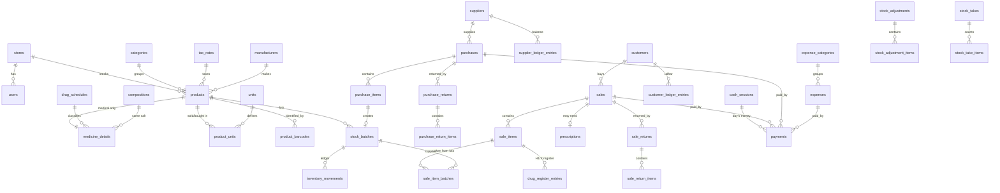

# Database Design

Status: **accepted 2026-11-11** (owner said to continue; no changes requested). Migrations are written phase by phase from this document; any change
is made here first.

## Conventions

| Topic | Rule |
|---|---|
| Engines | MySQL 8 / MariaDB 10.6+ (production) and SQLite 3 (tests, future desktop). No engine-specific SQL. |
| Primary keys | `id` unsigned big integer, auto-increment. |
| Public / sync id | `ulid` char(26), unique, on every transactional table. Generated by the client for create requests, so it doubles as the idempotency key. |
| Money amounts | `*_paise` signed big integer. ₹1 = 100. |
| Quantities | `qty*` signed big integer in the product's **base unit** (see `GENERAL_STORE_GUIDE.md`). |
| Rates | Per-unit cost rates: `decimal(18,6)`, read as strings, used only via the Rate helper; never summed in SQL. Tax percentages: `decimal(5,2)`. |
| Enumerations | `string` columns validated by PHP enums. No database `ENUM`. |
| Timestamps | UTC. `created_at`, `updated_at`. Business dates (`sale_date`, `expiry_date`) are `date` in shop local time (IST). |
| Soft delete | Only master data (products, customers, suppliers, categories, users). Never on transactional tables. |
| Multi-store | `store_id` on business tables. Version 1 has exactly one store row. |
| Foreign keys | Declared and enforced; `restrict` on delete for anything referenced by a transaction. |
| Snapshots | Transaction lines copy name, HSN, unit factor, price, tax rate and cost at the time, so history never changes. |
| Optimistic lock | Editable master rows have `version` integer; stale updates are rejected. |
| Append-only | `inventory_movements`, `payments`, `*_ledger_entries`, `audit_logs`, `drug_register_entries`: insert only. |

## Entity-relationship overview

## Tables

> **Built so far (2026-11-11):** shop/users/configuration, catalogue and stock tables. Differences between
> this design and what was built are listed under "As built" at the end. Parties, sales, purchases and money
> tables are not created yet.

### Shop, users, configuration

**stores** — name, legal_name, address, village, taluka, district, state_code, pincode, phone,
gst_mode (`unregistered` | `composition` | `regular`), gstin, timestamps.

**settings** — store_id, key, value (JSON text). Unique (store_id, key). Holds drug licence numbers and due
dates, bill header/footer, print format, alert periods, negative-stock rule, default language, round-off
rule, financial-year start, counter prefix, backup settings.

**users** — store_id, name, username (unique), mobile, email (nullable), password, pin (hashed, nullable),
locale, is_pharmacist, pharmacist_reg_no, is_active, last_login_at, soft delete.

**roles, permissions, model_has_roles, role_has_permissions** — from `spatie/laravel-permission`.
Seeded roles: Owner, Pharmacist, Store Manager, Cashier. Permissions are editable per role.

**number_sequences** — store_id, doc_type (`sale`, `sale_return`, `purchase`, `purchase_return`, `receipt`,
`rx_register`…), prefix, financial_year, next_number. Unique (store_id, doc_type, prefix, financial_year).
Incremented inside the document's transaction with a row lock.

**audit_logs** — store_id, user_id, action, subject_type, subject_id, old_values, new_values, reason, ip,
created_at. Index (subject_type, subject_id), (created_at).

**attachments** — attachable_type, attachable_id, disk, path, original_name, mime, size, sha256, uploaded_by.

**backups** — store_id, kind (`manual` | `auto` | `scheduled` | `before_restore`), file_name, local_path (nullable once
retention removed the copy), folder_path (verified copy in the backup folder, nullable), size_bytes, sha256, status
(`verified` | `failed`), error, warning (verified but e.g. folder missing), manifest (JSON: counts, schema, database
checksum), created_by, verified_at. The backup folder itself is the `backup_folder` setting.

### Catalogue

**categories** — store_id, parent_id (nullable; one level of subcategory), name, name_local, scope
(`medical` | `general` | `both`), color, icon, sort_order, soft delete.

**manufacturers** — name (unique per store).

**units** — code (PCS, TAB, CAP, STRIP, BTL, BOX, G, KG, ML, L, …), name, name_local. Global list, editable.

**tax_rates** — name ("GST 5%"), rate_percent, cess_percent (default 0), kind (`taxable` | `nil` | `exempt` |
`non_gst`), is_active. Rates are data; products point to a row. Sale and purchase lines copy the percentage.

**products** — store_id, type (`medical` | `general`), name, name_local, sku (unique per store,
auto-generated), category_id, brand, manufacturer_id, description, hsn_code, tax_rate_id, base_unit_id,
pricing_unit_id (→ product_units), default_sale_unit_id, default_purchase_unit_id, mrp_paise,
selling_price_paise (per pricing unit; defaults for new lots and for products without lot prices),
default_discount_percent, min_stock_qty, tracks_batch, tracks_expiry, allow_loose_sale, rack_location,
default_supplier_id, is_quick_item, search_text (lower-cased name + local name + brand + generic),
is_active, version, soft delete.
Indexes: (store_id, sku) unique; (store_id, search_text); (store_id, type, is_active); category_id.

**product_units** — product_id, unit_id, factor_to_base (integer ≥ 1), price_override_paise (nullable),
is_base. Unique (product_id, unit_id). Factor is locked once used in a transaction.

**product_barcodes** — store_id, product_id, product_unit_id (which pack the code represents), barcode,
is_internal. Unique (store_id, barcode).

**medicine_details** — product_id (PK/FK), generic_name, composition_id (nullable), composition_text,
composition_verified_by, composition_verified_at, strength, dosage_form, drug_schedule_id (nullable =
"not set"), is_ndps, storage_instructions.

**compositions** — normalised_key (unique, e.g. `paracetamol 500mg|tablet`), display_name. Used only for
the informational "same composition" list.

**drug_schedules** — code, name, requires_prescription, requires_prescriber, requires_patient,
requires_pharmacist, requires_register, register_retention_years, keep_prescription_copy, is_enabled,
warning_text, sort_order.

**product_price_history** — product_id, batch_id (nullable), field (`mrp` | `selling_price` |
`purchase_rate`), old_value, new_value, source_type, source_id, user_id, created_at.

### Stock

**stock_batches** (a "lot"; used for all products, visible to operators only when the product tracks
batches) — store_id, product_id, batch_no (nullable), mfg_date, expiry_date (nullable), mrp_paise,
selling_price_paise, cost_rate (per base unit), supplier_id, purchase_item_id (nullable), received_date,
qty_sellable, qty_unsellable, is_closed. Indexes: (product_id, expiry_date), (store_id, expiry_date),
(product_id, batch_no). `qty_*` are cached totals of the ledger and are checked by a reconciliation command.

**inventory_movements** — ulid, store_id, product_id, batch_id, bucket (`sellable` | `unsellable`),
qty_delta (signed), type (`opening` | `purchase` | `purchase_cancel` | `sale` | `sale_cancel` |
`customer_return` | `purchase_return` | `damage` | `expiry` | `adjustment` | `stock_take` | `bucket_transfer`),
source_type, source_id, cost_rate, balance_after, user_id, note, created_at.
Indexes: (batch_id, id), (product_id, created_at), (source_type, source_id), (type, created_at).

**stock_adjustments** — ulid, store_id, adjust_no, date, reason (`damage` | `expiry_writeoff` |
`count_correction` | `opening` | `other`), note, user_id.
**stock_adjustment_items** — stock_adjustment_id, batch_id, bucket, qty_delta, cost_rate.

**stock_takes** — ulid, store_id, scope (category/all), status (`open` | `posted` | `cancelled`),
started_by, posted_by, posted_at.
**stock_take_items** — stock_take_id, batch_id, system_qty, counted_qty, difference, counted_at.

### Parties

**customers** — ulid, store_id, name, mobile (indexed, not unique), address, village, type, gstin,
credit_limit_paise, balance_paise (cached; positive = customer owes shop), last_payment_at, notes,
is_active, version, soft delete.

**suppliers** — ulid, store_id, name, contact_person, mobile, address, gstin, drug_licence_no, kind
(distributor | wholesaler | manufacturer | other), payment_terms_days, balance_paise (cached; positive = shop owes
supplier), last_payment_at, notes, search_text, is_active, soft delete. Built 2026-11-26 (no `version` column).

**supplier_contacts** (built 2026-11-26, D-054) — store_id, supplier_id, name, role (mr | sales | delivery | accounts |
owner | other), company, mobile, visit_day (0–6), schemes, notes, is_active.

**supplier_ledger_entries** — as customer_ledger_entries, with `credit_paise` = the shop owes more (purchase) and
`debit_paise` = owes less (payment, return, reversal). Index (supplier_id, id).

**customer_ledger_entries** — ulid, store_id, customer_id, entry_date, type (`opening` | `sale` | `payment` |
`return` | `adjustment` | `reversal`), debit_paise, credit_paise, balance_after_paise, source_type,
source_id, reverses_id (nullable), note, user_id, created_at. Index (customer_id, id).

**supplier_ledger_entries** — same shape with supplier_id; types `opening` | `purchase` | `payment` |
`return` | `adjustment` | `reversal`.

### Sales

**sales** — ulid (unique; idempotency), store_id, invoice_no (nullable until completed; unique per store),
doc_kind (`tax_invoice` | `bill_of_supply` | `invoice_cum_bill_of_supply` | `cash_memo`), status (`held` |
`completed` | `cancelled`), sale_date, completed_at, customer_id (nullable), buyer_name, buyer_mobile,
buyer_gstin, hold_label, gross_paise, discount_paise, taxable_paise, cgst_paise, sgst_paise, igst_paise,
cess_paise, round_off_paise, total_paise, paid_paise, credit_paise, cost_paise, prescription_id,
verified_by_pharmacist_id, verified_at, cash_session_id, user_id, cancelled_by, cancelled_at, cancel_reason, notes.
Indexes: (store_id, sale_date), (customer_id, sale_date), (status).

**sale_items** — sale_id, line_no, product_id, product_name, hsn_code, product_unit_id, unit_code,
unit_factor, qty (in sale unit), qty_base, mrp_paise, unit_price_paise, discount_paise, tax_rate_percent,
cess_percent, tax_kind, taxable_paise, cgst_paise, sgst_paise, igst_paise, cess_paise, line_total_paise,
cost_paise, returned_qty_base, schedule_code (snapshot).

**sale_item_batches** — sale_item_id, batch_id, qty_base, cost_rate, returned_qty_base.

**prescriptions** — ulid, store_id, customer_id (nullable), serial_no, patient_name, patient_address,
patient_age, prescriber_name, prescriber_address, prescriber_reg_no, prescription_date, notes, created_by.
Photo via attachments. Access restricted by permission. (No `prescription_items` table: the dispensed
items are the linked sale's items.)

**drug_register_entries** — store_id, schedule_code, serial_no, entry_date, sale_id, sale_item_id,
prescription_id, drug_name, qty_text, manufacturer, batch_no, expiry_date, patient_name, patient_address,
prescriber_name, prescriber_address, pharmacist_id, created_at. Snapshot so the register never changes.

**sale_returns** — ulid, store_id, return_no (own `R` series), sale_id, customer_id, return_date, reason, refund_mode
(`refund` | `account_credit`), refund_method (cash/upi/card/bank when refunded), gross/discount/taxable/tax/round_off/total/cost paise, user_id.
Built 2026-11-19 (`exchange_credit` dropped, D-051).
**sale_return_items** — sale_return_id, sale_item_id, product_id, batch_id, unit_code, qty (in the sold unit), qty_base,
bucket (`sellable` | `unsellable`), the same amount fields as a bill line, restock_approved_by. Model guards refuse
any update or delete of sales, sale_items (except the `returned_qty_base` counter, upwards), sale_returns and sale_return_items.

### Purchases

**purchases** — ulid, store_id, purchase_no (own serial), supplier_id, supplier_invoice_no, invoice_date,
received_date, status (`draft` | `confirmed` | `cancelled`), gross_paise, discount_paise, taxable_paise,
cgst/sgst/igst/cess_paise, other_charges_paise, round_off_paise, total_paise, paid_paise, due_date, notes,
user_id, confirmed_at, cancelled_by, cancelled_at, cancel_reason.
Indexes: (supplier_id, supplier_invoice_no), (store_id, received_date), (status, due_date).

**purchase_items** — purchase_id, line_no, product_id, product_unit_id, unit_factor, qty, free_qty,
qty_base, rate_paise (per purchase unit, before tax), discount_percent, tax_rate_percent, cess_percent,
taxable_paise, tax fields, line_total_paise, batch_no, mfg_date, expiry_date, mrp_paise,
selling_price_paise, batch_id (set on confirm).

**purchase_returns** — ulid, store_id, return_no, supplier_id, purchase_id (nullable), return_date, reason,
totals, settlement (`reduce_balance` | `refund_received`), user_id.
**purchase_return_items** — purchase_return_id, batch_id, bucket, qty_base, rate, amount fields.

### Money

**payments** — every rupee in or out. ulid, store_id, direction (`in` | `out`), method (`cash` | `upi` |
`card` | `bank`), amount_paise, party_type/party_id (customer or supplier, nullable), payable_type/payable_id
(sale, sale_return, purchase, purchase_return, expense, or null for on-account), reference_no, paid_at,
business_date, cash_session_id, user_id, reverses_id, note.
Indexes: (cash_session_id, method), (business_date, method), (payable_type, payable_id), (party_type, party_id).
Udhar is not a payment method row — it is the unpaid remainder posted to the customer ledger.

**expense_categories** — name, name_local, is_active.
**expenses** — ulid, store_id, expense_category_id, amount_paise, expense_date, description, user_id,
cancelled_at. Its payment is a `payments` row (out).

**cash_sessions** (a business day or shift) — store_id, business_date, opened_by, opened_at,
opening_cash_paise, closed_by, closed_at, expected_cash_paise, counted_cash_paise, difference_paise, note,
status (`open` | `closed`).

**cash_movements** — cash that is not a sale/purchase/expense: cash_session_id, type (`cash_in` |
`bank_deposit` | `owner_withdrawal` | `other_out`), amount_paise, note, user_id.

## Integrity rules enforced in the database or service layer

1. `inventory_movements` is the truth; `stock_batches.qty_*` must equal the sum of movements per bucket.
   A scheduled command and a Settings screen check this and report differences.
2. Stock deduction uses a conditional update (`qty_sellable >= n`) so stock cannot go negative unless the
   store setting allows it.
3. Customer and supplier `balance_paise` must equal the last ledger entry's `balance_after_paise`; checked
   by the same command.
4. `sales.invoice_no`, `sale_returns.return_no`, `purchase_returns.return_no` are unique per store.
5. `sales.ulid` uniqueness makes a repeated "complete sale" request return the existing bill.
6. Sum of a sale's payments + `credit_paise` = `total_paise` for a completed sale.
7. A lot with `expiry_date` in the past cannot appear in `sale_item_batches` (service-layer check with test).
8. Rows in append-only tables are never updated except the documented cached counters
   (`returned_qty_base`, `qty_*`, `balance_paise`).

## Mapping from the brief's entity list

| Brief | Here |
|---|---|
| store_settings, application_settings | `settings` |
| product_variants | not created — each size is a product (see `DECISION_LOG.md` D-007) |
| medicine_batches | `stock_batches` (all products) |
| prescription_items | not created — sale items serve this purpose |
| sale_batches | `sale_item_batches` |
| sale_payments, purchase_payments | `payments` |
| customer_returns / supplier_returns | `sale_returns` / `purchase_returns` |
| customer_ledger / supplier_ledger | `*_ledger_entries` |
| cash_registers | `cash_sessions` |

About 45 tables including the permission tables. Stock transfers between locations and multi-branch are
not modelled beyond `store_id`.

## As built — differences from the design above (2026-11-11)

| Area | Design | As built | Why |
|---|---|---|---|
| Pricing unit | `products.pricing_unit_id`, `default_sale_unit_id`, `default_purchase_unit_id` | Flags `is_base`, `is_pricing` on `product_units`; one base unit and at most one pack unit per product for now | Avoids a circular foreign key; D-017 |
| `cost_rate` | "per base unit" | Paise per base unit, `decimal(18,6)` | D-018 |
| `stock_batches` | `supplier_id`, `purchase_item_id`, `is_closed` | Not present yet | Added by the Phase 4 purchase migration |
| `stock_adjustment_items` | Separate table | Not created; the adjustment header and its `inventory_movements` rows carry the lines | No extra information would be stored |
| `compositions`, `composition_verified_*` | Present | Not created; `medicine_details.composition_text` only | Arrives with the "same composition" list (requirement D7, V1) |
| `products` | `default_supplier_id`, image | Not present yet | Phase 4 / when uploads are built |
| `product_price_history` | `old_value`, `new_value`, `source_type/id` | `old_paise`, `new_paise`, `source` (text) | Values are always paise |
| `settings` | Negative-stock rule | Not implemented; negative stock is always refused | D-019 |
| `stock_takes` | Present | Not created | Physical count screen is V1 |
| `purchases` | `received_date`, `due_date`, totals, `paid_paise` | As designed plus `invoice_total_paise` (what the paper says), `inter_state`, `confirmed_by/at`; `purchase_no` is null while a draft; index (store_id, purchase_no) | Built 2026-11-26 (D-061) |
| `purchase_items` | `batch_id` set on confirm | Plus `product_name`, `hsn_code`, `unit_code`, `free_qty`, `qty_base` (billed + free), `cost_rate` (priced at draft save), `selling_price_paise` nullable; lines of a draft are replaced on every save | Same |
| `purchase_returns` | `purchase_id` nullable | No `purchase_id`: a debit note names batches, each batch knows its purchase line; `refund_method` added; unique (store_id, return_no) | Same |
| `purchase_return_items` | `rate`, amount fields | `cost_rate`, tax rate and split, `line_total_paise`, `product_name`, `batch_no`, `bucket` | Same |
| `stock_batches` | `supplier_id`, `purchase_item_id` | Added 2026-11-26 (nullable; null = opening stock) | Same |
